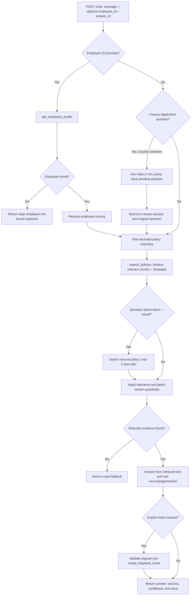

# Corvanta HR & IT Helpdesk Agent

A local, citation-aware Document Q&A assistant built for the Junior AI Engineer take-home assignment. It ingests the six supplied policy files, looks up employee profiles, supports explicit helpdesk ticket creation, and exposes `POST /chat` through FastAPI.

> **Implementation note:** the agent uses a bounded, transparent Python tool-routing loop so the repository runs without a paid LLM key. When installed, ChromaDB and Sentence Transformers provide vector retrieval using `all-MiniLM-L6-v2`; a lightweight lexical fallback supports tests in environments where those optional packages are not installed. The answer is assembled from retrieved policy passages rather than free-form model generation, which reduces unsupported claims. This is a deliberate baseline, not a claim that an LLM-based planner has been implemented.

## Features

- PDF and Markdown ingestion with page/section, country, document type, version, and effective-date metadata.
- Stable content-hash IDs and Chroma `upsert`, making repeated ingestion idempotent.
- Three tools: `search_policies`, `get_employee_profile`, and `create_helpdesk_ticket`.
- Employee country lookup and clarification when country is required but unknown.
- Current Leave Policy 2026 preferred over superseded 2025 policy.
- Two policy searches for questions combining business travel and leave.
- Explicit-intent gate for ticket creation; a question about a problem does not create a ticket.
- Five-tool-call maximum, source citations, fallback response, session-based clarification continuation, and safe API errors.

## Agent flow diagram



## Repository layout

```text
app/
  ingestion.py       # PDF/Markdown loading, chunking, metadata, vector indexing
  tools.py           # policy search, employee profile, ticket creation
  agent.py           # bounded tool-routing loop and guardrails
  main.py            # FastAPI POST /chat and session memory
data/                # supplied candidate data pack
  it-helpdesk-faq.md
  laptop-policy.pdf
  leave-policy-2025.pdf
  leave-policy-2026.md
  travel-policy-india.md
  travel-policy-sri-lanka.md
  employees.json
  tickets.json
tests/
requirements.txt
.env.example
.gitignore
```

## Setup

Python 3.11+ is recommended.

```bash
python -m venv .venv
# Windows PowerShell: .venv\Scripts\Activate.ps1
# macOS/Linux: source .venv/bin/activate
pip install -r requirements.txt
python -m app.ingestion
uvicorn app.main:app --reload
```

The first vector indexing run downloads the `sentence-transformers/all-MiniLM-L6-v2` model if it is not already cached. If ChromaDB/Sentence Transformers are unavailable, ingestion writes a local chunk JSON fallback for development. Do not commit `.chroma/`, `.env`, virtual environments, or secrets.

API docs: http://127.0.0.1:8000/docs

## API contract

Request:

```json
{
  "message": "How many days of annual leave can I carry forward?",
  "employee_id": "E1003",
  "session_id": "leave-demo"
}
```

Response shape:

```json
{
  "answer": "According to the current Leave Policy 2026 ...",
  "sources": ["leave-policy-2026.md - 6. Carry-Forward of Annual Leave"],
  "confidence_flag": "high",
  "tool_calls": [
    {"tool": "get_employee_profile", "input": {"employee_id": "E1003"}},
    {"tool": "search_policies", "input": {"query": "...", "country": "IN", "doc_type": "leave"}}
  ],
  "ticket_id": null
}
```

## Example requests

### Single-policy answer

```bash
curl -X POST http://127.0.0.1:8000/chat \
  -H "Content-Type: application/json" \
  -d '{"message":"How many days of annual leave can I carry forward?","employee_id":"E1003","session_id":"leave-demo"}'
```

### Multi-policy question (leave + business travel)

```bash
curl -X POST http://127.0.0.1:8000/chat \
  -H "Content-Type: application/json" \
  -d '{"message":"I am taking 3 days of leave for a business trip to Colombo. What approvals do I need?","employee_id":"E1003","session_id":"travel-demo"}'
```

Expected routing includes two `search_policies` calls: one for leave policy and one for travel policy. The home-country policy is used for travel, even if the destination is another country.

### Clarification across two turns

First request (no employee ID or country):

```bash
curl -X POST http://127.0.0.1:8000/chat -H "Content-Type: application/json" \
  -d '{"message":"What is my daily travel allowance?","session_id":"allowance-demo"}'
```

The assistant asks whether the employee is based in India or Sri Lanka. Continue using the **same `session_id`**:

```bash
curl -X POST http://127.0.0.1:8000/chat -H "Content-Type: application/json" \
  -d '{"message":"I am in Sri Lanka","session_id":"allowance-demo"}'
```

### Ticket creation (explicit request only)

```bash
curl -X POST http://127.0.0.1:8000/chat -H "Content-Type: application/json" \
  -d '{"message":"My laptop screen is broken, please raise a ticket.","employee_id":"E1004","session_id":"ticket-demo"}'
```

The returned ticket ID is appended to `data/tickets.json`. Asking “What should I do if my laptop screen breaks?” does **not** create a ticket.

## Retrieval choices and threshold

- Intended embedding model: `sentence-transformers/all-MiniLM-L6-v2`, a compact local sentence embedding model.
- Vector store: persistent local ChromaDB with cosine distance.
- Chunking: up to 180 words with 35-word overlap; Markdown heading boundaries and PDF page boundaries are preserved in metadata. Short sections remain whole, helping keep numbered steps and tables together where possible.
- Metadata: `source`, `page_or_section`, `country`, `doc_type`, `version`, and `effective_date`.
- Vector relevance threshold: cosine similarity **0.30** as an initial conservative value; lexical fallback threshold **0.08** is a separate heuristic score and is not numerically comparable. These are starting thresholds and should be tuned against a labelled in-scope/out-of-scope question set, measuring recall and false acceptance before submission.
- Repeated ingestion is idempotent because chunk IDs are deterministic hashes and Chroma uses `upsert`.

## Tool definitions

| Tool | Inputs | Output | Safety / purpose |
|---|---|---|---|
| `search_policies` | `query`, optional `country`, `doc_type` | Ranked chunks with citation metadata and score | Read-only; country/type filters narrow retrieval. |
| `get_employee_profile` | `employee_id` | Employee profile or not-found | Reads only the provided `employees.json`. |
| `create_helpdesk_ticket` | `category`, `summary` | Ticket ID such as `HD-1001` | Writes only after explicit ticket intent; validates category. |

Tools separate trusted, deterministic operations from the conversational routing logic. The profile tool prevents guessing the employee's home country; policy search provides grounded evidence; ticket creation is a side effect behind a separate explicit-intent gate.

## Example tool traces

These are illustrative routing traces; exact retrieval results and source ordering depend on the indexed corpus and retrieval backend.

1. **Carry-forward leave**: `get_employee_profile(E1003)` → `search_policies(query, country=IN, doc_type=leave)` → answer from `leave-policy-2026.md`, section 6; cite the current policy and state its version.
2. **Three leave days during a Colombo business trip**: `get_employee_profile(E1003)` → `search_policies(..., doc_type=leave)` → `search_policies(..., doc_type=travel)` → combine personal leave approvals from Leave Policy 2026 with travel approvals from the employee's home-country travel policy.
3. **Broken laptop with explicit ticket request**: `get_employee_profile(E1004)` → `search_policies(..., doc_type=laptop)` → `create_helpdesk_ticket(category=hardware, summary=...)` → return the ticket ID and relevant policy source. Without explicit ticket wording, the create tool is not called.

## Tests

```bash
pytest -q
```

The suite covers a single-document answer, two-policy search, country clarification, out-of-scope fallback, no ticket on a question alone, explicit ticket creation, unknown employee IDs, and empty API messages.

## Scenario questions from the assignment

1. **Hallucination despite correct retrieval:** a generative model may complete patterns from prior training instead of limiting itself to context. Use an instruction to answer only from cited context and explicitly say when evidence is absent; lower temperature and validate each factual claim against retrieved text. Test with a document containing one fact and ask for a plausible but absent related fact; assert the absent fact is not returned.
2. **Fallback for a valid question:** inspect ingestion, PDF/Markdown extraction, chunk boundaries, embedding model consistency, metadata filters, top-k, and similarity scores in that order. Tune the threshold on labelled in-scope paraphrases and out-of-scope questions; track recall and false acceptance rather than selecting a threshold by intuition alone.
3. **Out-of-scope answer:** a model may answer from general training knowledge even when retrieval is irrelevant. Enforce a minimum retrieval score before generation, pass only relevant retrieved context, and return the exact fallback if no chunk clears the threshold. Test with unrelated general-knowledge prompts.
4. **Wrong source citation:** source metadata may be taken from a different result, shared mutable state, or a reordered chunk list. Carry metadata with each retrieved chunk object end-to-end and derive citations from the exact chunks used in the answer. Test with distinctive facts in two files and assert each answer cites the correct file/section.
5. **Missing step after chunk split:** fixed-size chunking can separate sequential steps, and top-k may retrieve only the first chunk. Keep numbered procedures together where possible, preserve page/section metadata, use overlap, and retrieve adjacent chunks when a step-by-step section is matched. Test that a VPN answer contains all required steps.
6. **Search loop:** the planner may not have a stopping rule or may not treat repeated low-relevance results as evidence to stop. Enforce the five-call limit, track repeated queries/results, stop on low relevance, and return a partial answer or fallback. This implementation has a hard call limit and a fixed bounded search plan for cross-policy questions.
7. **Unrequested ticket:** the model may infer an action from the problem description rather than the user's intent. Keep ticket creation behind a deterministic explicit-request gate, validate category/summary, and do not let retrieval itself trigger writes. Test that “my screen is broken, what should I do?” leaves `tickets.json` unchanged, while “please raise a ticket” creates exactly one ticket.

## AI coding tools

AI assistance was used to help draft and review parts of the implementation and documentation. The candidate should review, run, and understand every module and be prepared to explain the design decisions and limitations.

